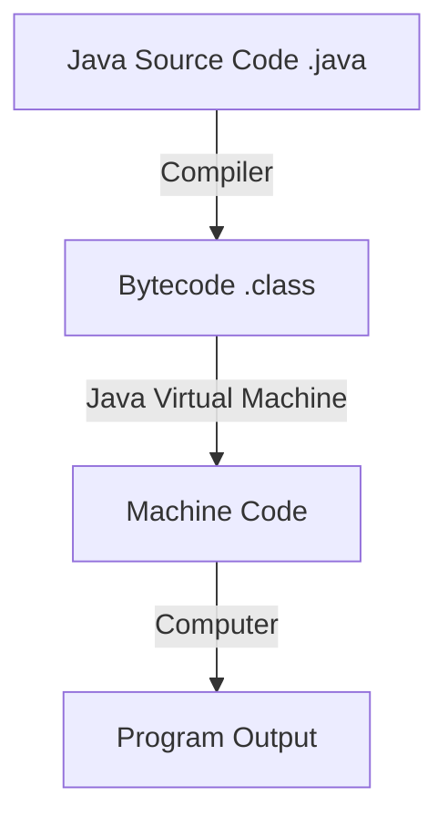

---
aliases:
  - JRE
  - JDK
  - JVM
draft: false
tags:
  - Java
---

## What is Java?
- high level, object-oriented programming language
- platform-independent
- secure, reliable
- suitable for large systems
- `.java` file extension
## Java Development Kit (JDK)
- needed to **write, compile & run** Java programs
- includes the compiler, [[#Java Runtime Environment (JRE|JRE]] and development tools
## Java Runtime Environment (JRE)
- *only* used to **run** programs
- does **NOT** include the compiler, cannot compile new Java programs
- includes the [[#Java Virtual Machine (JVM)|JVM]]
## Java Virtual Machine (JVM)
While most language compilers translate source code to machine code for a *specific* computer, the Java compiler translates source code to **bytecode** with a `.class` extension.

JVM runs the bytecode and **translates it to machine code**. Different Operating Systems have *different JVMs*, but they all ==understand the same `.class` bytecode==, allowing it to run anywhere regardless of platform, hence the slogan "write once, run anywhere".

## Basic Java Rules
- Java is *case-sensitive*
- every statement ends with a semicolon `;`
- file name and public class name are the *same*
- code blocks use braces `{}`
- class names should start with a capital letter
- variable names usually start with a small letter